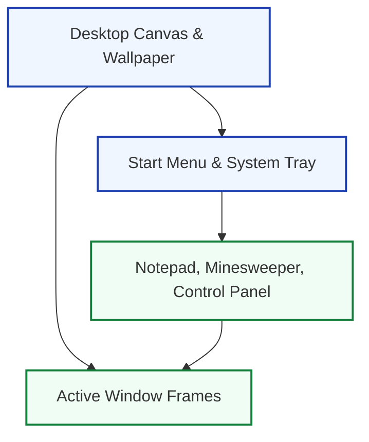

# Windows Nostalgia — Retro 90s Desktop Web Simulation

**A nostalgic, lightweight recreation of the classic Windows 95/98 desktop interface built entirely in vanilla HTML, CSS, and JavaScript.**

---

## 🖥️ Interactive Desktop Features

- **Icon Grid**: Draggable retro icons with authentic pixel art.
- **Classic Start Menu**: Cascading hierarchical start menu with nostalgic sound effects.
- **Window Management**: Movable, minimizable, and maximizable window frames.

---

## 🚀 Run Locally

Simply open `index.html` in any web browser!

---

## 📬 Authors

- **Collaborators**: Waleed & Sayan Bhattacharya ([sayanpm17@gmail.com](mailto:sayanpm17@gmail.com))
